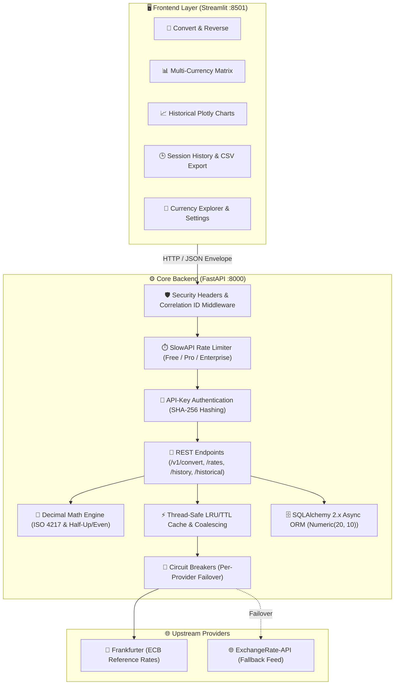

# 💱 Forex-Core

### ⚡ High-Precision FX Conversion Engine & Multi-Currency Analytics Platform

[](https://www.python.org/)
[](https://fastapi.tiangolo.com)
[](https://streamlit.io)
[](#-testing--code-quality)
[](https://github.com/astral-sh/ruff)
[](http://mypy-lang.org/)

**Forex-Core** is an asynchronous financial foreign exchange rate and currency conversion engine built with **FastAPI** and **Streamlit**. It is engineered to institutional financial requirements: zero floating-point math, ISO 4217 minor-unit rounding, multi-provider circuit breakers, single-flight request coalescing, and encrypted API-key rate tiering.

---

## 🏛️ System Architecture



---

## 💎 Financial Engineering Principles

### 🎯 1. Zero Floating-Point Arithmetic
- Float types (`float`) are strictly forbidden across all currency operations.
- Upstream JSON payloads are parsed directly into Python standard library `decimal.Decimal` without passing through IEEE 754 representations.
- All monetary amounts in API responses are serialized as strings to preserve client-side decimal precision.

### 📐 2. ISO 4217 Minor-Unit Rounding
- Precision rounding is applied **only** to the final converted amount according to the target currency's standard minor units:
  - `0 decimals`: JPY, KRW, VND, HUF
  - `2 decimals`: USD, EUR, GBP, INR, CAD, AUD
  - `3 decimals`: KWD, BHD, OMR, JOD
- Supports configurable rounding policies via environment (`ROUND_HALF_UP` default, `ROUND_HALF_EVEN` financial banker's rounding).

### 🛡️ 3. Multi-Provider Resilience & Failover
- **Decoupled Provider Interface**: Business logic depends exclusively on the abstract `RateProvider` protocol.
- **Automatic Failover**: Transparently shifts from Frankfurter to ExchangeRate-API when the primary feed fails.
- **Circuit Breakers**: Independent tri-state machines (`CLOSED`, `OPEN`, `HALF_OPEN`) per provider prevent cascading failures during outages.
- **Single-Flight Request Coalescing**: Collapses concurrent queries for the same currency pair into one external network call.
- **Stale Serving**: Serves cached last-known-good rates with transparent indicators (`meta.stale = true`, `meta.age_seconds`).

### 🗄️ 4. Data Depth & Timeseries Analytics
- **Explicit Precision**: Stored with SQLAlchemy 2.x async ORM using `Numeric(20, 10)` SQL column types.
- **Pure Decimal Statistics**: Timeseries queries calculate min, max, average, and percentage change without float approximation.
- **Session History & CSV Streaming**: Automatically logs conversion activity and streams RFC 4180 compliant CSV exports.
- **Favorites Management**: Session-based favorite currency pair tracking.

### 🔐 5. Security & Rate Limiting
- **Hashed API Keys**: High-entropy keys (`ak_<token>`) stored exclusively as deterministic SHA-256 digests.
- **Tier-Based Rate Limits**:
  - 🟢 `Free Tier`: 60 req/min (per client IP or free key)
  - 🟡 `Pro Tier`: 300 req/min
  - 🟣 `Enterprise Tier`: 1200 req/min
- **Hardened HTTP Headers**: Automatically sets HSTS, CSP (`frame-ancestors 'none'`), `X-Frame-Options: DENY`, `X-Content-Type-Options: nosniff`, and `Referrer-Policy`.

---

## 🖥️ Streamlit Frontend Suite

The Streamlit UI provides 7 interactive workspaces:

1. **🔄 Convert Currency**: Real-time forward conversion with interactive swap (`⇄`), live rates, inverse rates, and favorite star toggling.
2. **↩️ Reverse Conversion**: Calculate required source amount to obtain an exact target payout.
3. **📊 Multi-Currency Matrix**: Real-time multi-currency matrix converting a base amount across favorite and major world currencies.
4. **📈 Historical Trends**: Interactive Plotly charts across configurable ranges (`7D`, `1M`, `3M`, `6M`, `1Y`, `5Y`) with Decimal stats cards.
5. **🕒 Conversion History**: Searchable audit log of session conversions with direct one-click CSV download.
6. **🧭 Currency Explorer**: Full searchable catalog with flags, symbols, minor units, and live reference rates.
7. **⚙️ Preferences & Settings**: Customizable number formatting (US `1,234.56` vs EU `1.234,56`), base currency, and rounding rules.

---

## 📡 API Endpoints Reference

All endpoints return a unified response envelope (`success`, `data`, `meta`, `error`):

| Method | Endpoint | Description | Auth / Tier |
|---|---|---|---|
| `GET` | `/health` | Liveness health check | Public |
| `GET` | `/ready` | Database & provider readiness probe | Public |
| `GET` | `/v1/convert` | Forward currency conversion | Tier-Limited |
| `GET` | `/v1/convert/reverse` | Reverse target amount calculation | Tier-Limited |
| `POST` | `/v1/convert/batch` | Batch conversion (one-to-many or pair list) | Tier-Limited |
| `GET` | `/v1/rates` | Multi-symbol latest exchange rates | Tier-Limited |
| `GET` | `/v1/rates/{base}/{target}` | Direct pair latest exchange rate | Tier-Limited |
| `GET` | `/v1/currencies` | ISO 4217 currency list & metadata | Tier-Limited |
| `GET` | `/v1/historical` | Historical single-date exchange rates | Tier-Limited |
| `GET` | `/v1/timeseries` | Historical range with min, max, avg, % change | Tier-Limited |
| `GET` | `/v1/history` | Paginated conversion audit records | Tier-Limited |
| `GET` | `/v1/history/export` | RFC 4180 streaming CSV export | Tier-Limited |
| `POST` | `/v1/favorites` | Add currency to session favorites | Tier-Limited |
| `POST` | `/v1/auth/keys` | Issue a new tier-backed API key | Public |
| `GET` | `/v1/auth/verify` | Verify key validity and tier allocation | Key Required |
| `POST` | `/v1/auth/revoke` | Revoke an active API key | Key Required |

---

## 🚀 Quickstart & Local Setup

### 📦 1. Installation
```bash
# Clone the repository
git clone https://github.com/pabitralenka07/Forex-core.git
cd Forex-core

# Create and activate virtual environment
python3 -m venv .venv
source .venv/bin/activate

# Install dependencies
pip install -r backend/requirements.txt
pip install streamlit plotly pandas slowapi
```

### 🔌 2. Starting the FastAPI Backend
```bash
PYTHONPATH=backend ./.venv/bin/uvicorn app.main:app --reload --port 8000
```
- 📖 **Interactive Swagger UI**: [http://localhost:8000/docs](http://localhost:8000/docs)
- 📑 **ReDoc Documentation**: [http://localhost:8000/redoc](http://localhost:8000/redoc)
- 💓 **Health Endpoint**: [http://localhost:8000/health](http://localhost:8000/health)

### 🎨 3. Starting the Streamlit Frontend
```bash
./.venv/bin/streamlit run frontend/app.py --server.port 8501
```
- 🌐 **Web Dashboard**: [http://localhost:8501](http://localhost:8501)

---

## 🧪 Testing & Code Quality

The automated test suite contains **91 passing tests** covering unit, integration, and Hypothesis property tests:

```bash
# Run all 91 tests
./.venv/bin/pytest backend/tests -v

# Run Ruff linter
./.venv/bin/ruff check backend frontend

# Run strict Mypy type checker
(cd backend && ../.venv/bin/mypy app tests) && ./.venv/bin/mypy frontend
```

---

## ⚠️ Provider Transparency & Financial Disclaimers

- **Indicative Reference Quotes**: Upstream Frankfurter rates are European Central Bank (ECB) reference rates published once daily on business days (around 16:00 CET). They are indicative benchmarks, not real-time executable trading quotes.
- **Zero Hallucination Policy**: If an upstream provider does not have data for a specific date or pair, missing data is reported accurately as missing; rates and historical entries are never fabricated.
